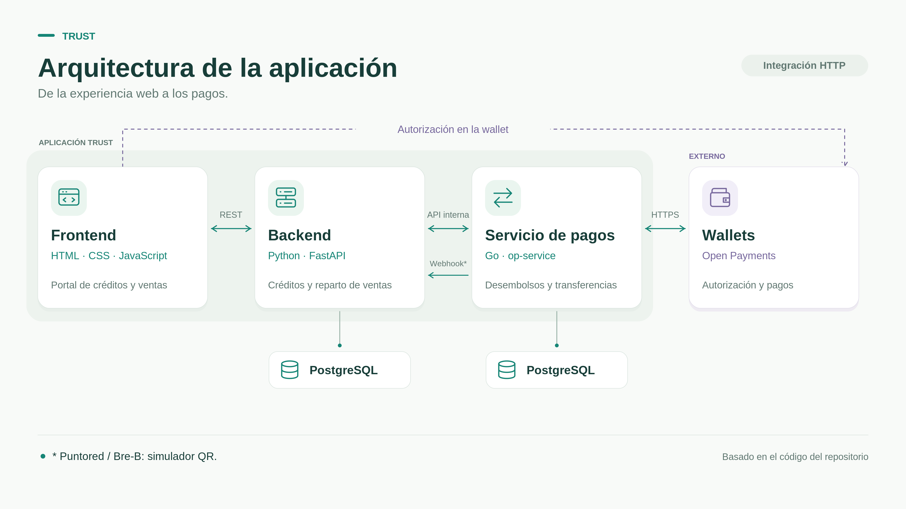

# Trust

**Credit for small businesses, repaid with every sale through Open Payments.**

Team Basis Network · Open Payments Hackathon Medellín 2026 (Interledger Foundation + Ruta N)

**Live:** [app.trustservices.com.co](https://app.trustservices.com.co) (web app) · [trustservices.com.co](https://trustservices.com.co) (landing)

## The problem

Small businesses (MiPymes) in Colombia struggle to get credit and end up borrowing from informal lenders at abusive rates. People who want to lend have no trustworthy way to know who to lend to.

## The solution

Trust calculates each merchant's credit limit from their sales and matches merchant requests with lender offers. Once a loan is active, every customer payment is split automatically: most of it goes to the merchant and an agreed percentage repays the lender, sale by sale. Lenders authorize the disbursement in their own wallet, and every movement is traceable.

Lenders can fund loans from any Open Payments wallet, even one in another currency: the disbursement uses a quote with a fixed amount for the merchant, so a lender abroad can fund a merchant in Colombia. Merchant wallets use COP.

## How Trust uses Open Payments

A Go service built on the official SDK ([`open-payments-go`](https://github.com/interledger/open-payments-go) v0.5.0) is the only component that talks to wallets:

- **Wallet addresses**: resolves merchant, lender and collection wallets.
- **Interactive grants**: the lender approves each disbursement in their wallet; Trust continues the grant and rotates tokens.
- **Incoming payments, quotes and outgoing payments**: disburse loans and split each sale between merchant, lender and Trust.
- **Reliability**: idempotency keys, durable jobs in PostgreSQL and reconciliation of uncertain payments.

## Architecture



Frontend → Trust API (FastAPI) → op-service (Go) → Open Payments wallets. Each service owns its PostgreSQL database. The API decides who receives how much; the Go service executes the payments.

| Component | Stack | Folder |
| --- | --- | --- |
| Web app | HTML, CSS, JavaScript (ES modules) | [`frontend/`](frontend/README.txt) |
| Landing page and waitlist | Astro, TypeScript | [`landing/`](landing/README.md) |
| Business API: credit limits, matching, loans, sale splits | Python 3.12, FastAPI, SQLAlchemy | [`backend/`](backend/README.md) |
| Payments service: Open Payments | Go, `open-payments-go` | [`open-payments/`](open-payments/README.md) |
| Deployment | Docker Compose, Nginx, Traefik | [`deploy/aws/`](deploy/aws/compose.yaml) |

## Live deployment

Everything is deployed and running:

| | URL |
| --- | --- |
| Landing | https://trustservices.com.co |
| Web app | https://app.trustservices.com.co |
| API health | https://api.trustservices.com.co/api/v1/health |
| Payments health | https://pay.trustservices.com.co/v1/health |

Payments run on the Interledger Test Wallet in COP. Puntored does not support Open Payments yet, so the Puntored / Bre-B QR payment entry is simulated.

## Run locally

Requires Docker, [uv](https://docs.astral.sh/uv/) and Python 3.12. With `OP_CLIENT=fake` no Go service or wallet is needed.

```bash
cd backend && docker compose up -d db && uv sync --frozen && cp .env.example .env
# Edit backend/.env: set JWT_SECRET, OP_CLIENT=fake, DEV_ENDPOINTS_ENABLED=true
cd ../frontend && python3 scripts/dev.py --seed   # open http://127.0.0.1:5173
```

Full setup and demo accounts: [Local development](docs/tecnica/operacion.md#desarrollo-local). Go service: [open-payments/README.md](open-payments/README.md).

## Documentation

Technical docs are in Spanish.

| Topic | Link |
| --- | --- |
| Documentation index | [docs/README.md](docs/README.md) |
| Architecture | [docs/tecnica/arquitectura.md](docs/tecnica/arquitectura.md) |
| Domain and flows: credit limit, matching, loan states, sale split | [docs/tecnica/dominio-y-flujos.md](docs/tecnica/dominio-y-flujos.md) |
| Data model | [docs/tecnica/modelo-de-datos.md](docs/tecnica/modelo-de-datos.md) |
| APIs and integration | [docs/tecnica/apis.md](docs/tecnica/apis.md) |
| Operations and deployment | [docs/tecnica/operacion.md](docs/tecnica/operacion.md) |
| Verification and known limits | [docs/tecnica/verificacion-y-pendientes.md](docs/tecnica/verificacion-y-pendientes.md) |
| OpenAPI contracts | [contracts/](contracts/) |
| Backend specs and acceptance criteria | [backend/specs/](backend/specs/README.md) |
| AI usage and prompts | [AI_USAGE.md](AI_USAGE.md) · [prompts/](prompts/) |
