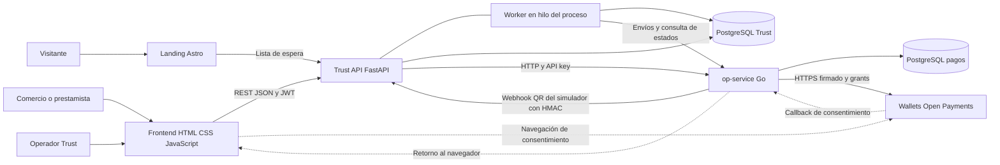

# Arquitectura de Trust

Trust separa la lógica del crédito de la ejecución de pagos. La API Python determina quién debe recibir cuánto, mientras Go administra la autorización y las operaciones Open Payments. Ambos mantienen su propia persistencia y se comunican por HTTP; no comparten transacciones de base de datos.

## Componentes y comunicaciones

Las flechas representan comunicaciones. Las wallets externas ejecutan los movimientos de dinero; las tablas de Trust registran obligaciones, repartos y resultados. Las bases pueden residir en un mismo servidor PostgreSQL, como ocurre en el Compose integrado.

| Componente | Responsabilidad | Punto de entrada |
| --- | --- | --- |
| `frontend/` | Registro, perfil, mercado, detalle de crédito, wallet, notificaciones y administración | [app.js](../../frontend/src/app.js) |
| `landing/` | Presentación pública y captación de comercios y prestamistas | [src/pages/](../../landing/src/pages/) |
| `backend/` | Identidad, scoring, mercado, préstamos, reparto, contabilidad y consulta | [main.py](../../backend/app/main.py) |
| Worker Python | Enviar y seguir repartos, seguir desembolsos, vencer pendientes y cerrar periodos | [worker.py](../../backend/app/worker.py) |
| `open-payments/` | Resolver wallets, administrar grants, cuentas de recaudo, pagos, transferencias y simulación QR | [main.go](../../open-payments/cmd/op-service/main.go) |
| `deploy/aws/` | Construcción y ejecución conjunta sobre un host con Docker y Traefik/Dokploy existente | [compose.yaml](../../deploy/aws/compose.yaml) |

No hay un cliente móvil nativo en este árbol. Sí hay contrato compartido y retorno `client=mobile` que puede abrir `trust://loans/{id}`. Tampoco se utiliza un broker externo para los trabajos: Python ejecuta un hilo y Go guarda trabajos durables en PostgreSQL.

## Organización del backend

Las rutas validan entrada y dependencias de acceso; los servicios aplican reglas y coordinan transacciones; los modelos representan persistencia. `app/policies/` contiene cálculos puros sin red ni base de datos. `app/integrations/op/` encapsula la dependencia de pagos.

| Módulo | Función |
| --- | --- |
| `users` | Registro, JWT, perfil, rango del prestamista y wallet de destino |
| `recaudo` | Asignación y consulta del QR/cuenta del comercio |
| `scoring` | Features de ventas, evaluación versionada y cupo |
| `marketplace` | Solicitudes, ofertas y matches calculados al consultar |
| `loans` | Preview, aceptación, rechazo, cancelación, desembolso y revisión de porcentaje |
| `sales` | Recepción del webhook, deduplicación, reparto y creación de abonos y pagos |
| `repayments` | Listado de abonos y trazabilidad de su entrega |
| `dashboard` | Resúmenes para comercios y prestamistas |
| `notifications` | Avisos persistidos y marcado de lectura |
| `waitlist` | Captación pública, deduplicación por correo y control de frecuencia |
| `admin` | Resumen operativo, reintento de pagos y revocación de recaudo |
| `platform` | Salud, configuración pública y herramientas de demo |

El proceso inicia con `Base.metadata.create_all`, inicializa el cliente de pagos y, si está habilitado, arranca el worker. Se requiere **un solo proceso Uvicorn**, `--workers 1`. Lanzar varias réplicas sin rediseñar esa coordinación también multiplica workers y límites de frecuencia en memoria.

## Frontend y landing

La aplicación es un sitio de varias páginas HTML con módulos JavaScript, sin framework de UI ni dependencias de producción declaradas en `frontend/package.json`. [app.js](../../frontend/src/app.js) carga el perfil, comprueba el rol esperado e importa el módulo de la página. La autorización efectiva la repite el backend.

[api.js](../../frontend/src/lib/api.js) resuelve operaciones desde un mapa generado, envía Bearer tokens y normaliza errores. El token se guarda en `sessionStorage` bajo `trust.session.v1`; los borradores de solicitudes/ofertas usan `localStorage`. Cerrar sesión borra el token local. Un `401` en una operación protegida limpia la sesión y redirige al acceso.

`apiBaseUrl` vacío utiliza `/api/v1` en el mismo origen mediante proxy. El tiempo máximo de espera del cliente es 15 segundos por defecto. El frontend obtiene la configuración pública desde la API y trata los importes como dinero con código y escala.

La actualización es por consultas periódicas: ventas cada 2,5 segundos, desembolso/retorno cada 2 segundos y notificaciones cada 30 segundos. No hay WebSockets ni notificaciones push. El parámetro `op_status` del retorno es orientativo: [return.js](../../frontend/src/pages/return.js) consulta el crédito para confirmar su estado.

La landing usa Astro, genera contenido estático y envía su formulario a `PUBLIC_WAITLIST_ENDPOINT`. Sin esa variable, comunica que el formulario no está conectado. Admite JSON con JavaScript y envío de formulario sin JavaScript. El backend devuelve JSON o una redirección según la modalidad. La landing configura sus enlaces y metadatos mediante variables públicas de compilación; no debe recibir secretos.

Fuentes: [configuración frontend](../../frontend/src/config.js), [build frontend](../../frontend/scripts/build.py), [configuración Astro](../../landing/astro.config.mjs), [formulario](../../landing/src/components/waitlist/WaitlistForm.astro).

## Modos de integración

| Modo | Configuración | Qué se ejecuta |
| --- | --- | --- |
| Fake en proceso | `OP_CLIENT=fake` | `FakeOpClient`, estados en memoria y wallet de consentimiento falsa servida por Python; no requiere Go |
| Mock HTTP | `OP_CLIENT=http` apuntando al mock en 8090 | Cliente HTTP verdadero contra un simulador FastAPI en memoria; sin Open Payments externo |
| Servicio Go | `OP_CLIENT=http` apuntando a Go en 8080 | Persistencia de pagos, grants y llamadas HTTPS a las wallets configuradas |

`OP_CLIENT=http` por sí solo no identifica qué hay al otro extremo. Con Go, `SIM_ENABLED=true` habilita la entrada QR simulada, que puede producir operaciones en las wallets configuradas. `SIM_ENABLED=false` la deshabilita; no activa automáticamente un proveedor Puntored/Bre-B productivo.

La reconstrucción de cuentas de recaudo al arrancar el fake no equivale a persistir íntegramente todos sus pagos en memoria. Para pruebas de recuperación del servicio financiero se necesita el modo Go y su base de datos.

Fuentes: [selección del cliente](../../backend/app/integrations/op/client.py), [fake](../../backend/app/integrations/op/fake.py), [mock HTTP](../../backend/tools/mock_op_service/README.md), [servicio Go](../../open-payments/internal/application/service.go).

## Despliegue disponible

El Compose integrado construye frontend y landing en contenedores Nginx, ejecuta FastAPI y añade Go con el perfil `payments`. Usa PostgreSQL 16 con bases `trust` y `op_service`, una red privada de datos y la red externa `dokploy-network` para Traefik. No provisiona por sí mismo la instancia AWS, DNS ni el proxy existente.

El Compose propio de Go es una alternativa con PostgreSQL 17 y Caddy; no debe confundirse con el despliegue integrado. La topología y los procedimientos se detallan en [operación](operacion.md).
