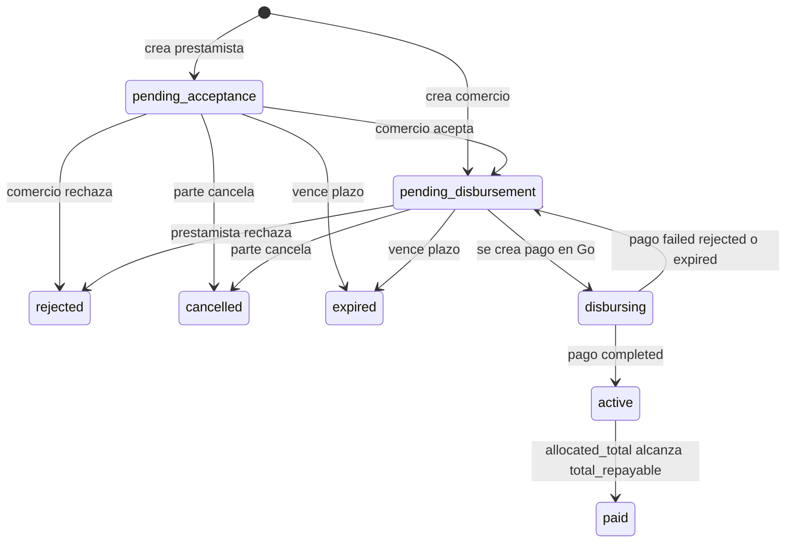
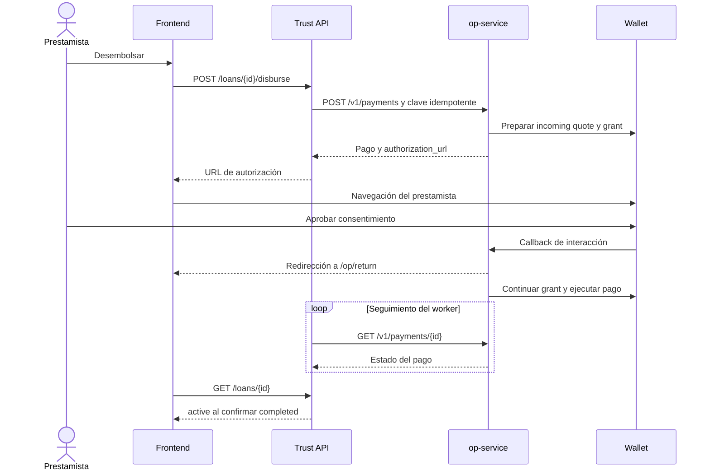

# Dominio y flujos de Trust

El comercio obtiene un crédito y destina un porcentaje de cada venta a amortizarlo. El prestamista aporta el capital y recibe el neto de los abonos. Trust calcula el cupo y los términos, registra la asignación de fondos y cobra una parte del cargo del crédito según la política configurada.

## Actores y convenciones

| Actor | Capacidades principales |
| --- | --- |
| `merchant` | Vincular wallet, activar recaudo, consultar cupo, publicar solicitud, tomar oferta, aceptar propuesta y consultar ventas/créditos |
| `lender` | Vincular wallet, definir rango, publicar ofertas, fondear solicitudes, autorizar desembolsos y consultar abonos |
| `admin` | Consultar indicadores operativos, reintentar pagos retenidos o fallidos y revocar cuentas de recaudo |

Cada usuario tiene un solo rol. El registro público admite comercio o prestamista; no crea administradores. La wallet propia del comercio, donde recibe dinero, es distinta conceptualmente de su cuenta de recaudo gestionada por Trust.

Los importes se calculan con enteros en unidades mínimas. Con COP y escala 2, `4800000` equivale a $48.000. Los porcentajes se representan en puntos básicos: `1500 bps = 15 %`; `10000 bps = 100 %`. Los ejemplos siguientes usan esa configuración de mercado.

## Alta y cuenta de recaudo

1. El usuario se registra y recibe un JWT.
2. Vincula su wallet; Python solicita a Go su resolución. La wallet del comercio debe coincidir con el asset de mercado; la del prestamista puede usar otro asset.
3. El comercio solicita su cuenta de recaudo. Go asigna una wallet disponible del pool previamente autorizado por el operador.
4. Python conserva el identificador remoto, la dirección y el QR. Un comercio puede tener varias cuentas históricas, pero una sola activa.

La asignación es idempotente y puede recuperar una cuenta ya asignada en Go. Un pool agotado o sin wallets autorizadas impide crear nuevos recaudos. La salud HTTP del servicio no demuestra que el pool tenga consentimiento vigente.

Fuentes: [usuarios](../../backend/app/modules/users/service.py), [recaudo](../../backend/app/modules/recaudo/service.py), [asignación del pool](../../open-payments/internal/application/accounts.go).

## Scoring y cupo

La política `v1` es determinística y no usa un modelo de aprendizaje automático. Combina cinco componentes normalizados entre 0 y 10000:

| Componente | Peso | Cálculo o ventana |
| --- | --- | --- |
| Volumen | 35 % | Promedio de ventas de los tres últimos meses cerrados frente a `SCORE_VOLUME_REF` |
| Consistencia | 25 % | Semanas con ventas de al menos la mitad del promedio semanal en las 12 semanas cerradas anteriores |
| Días activos | 15 % | Días con ventas en los 90 días anteriores a hoy |
| Antigüedad | 10 % | Meses completos desde la primera venta, saturando a los 12 meses |
| Historial de crédito | 15 % | Base 5000, más 2500 por crédito pagado, menos 1000 por revisión registrada como `missed_minimum`, acotado a 0–10000 |

El score es `sum(peso_bps × componente_bps) // 100000`, entre 0 y 1000. Los grados son A desde 750, B desde 600, C desde 450 y D por debajo.

La elegibilidad requiere `MIN_MONTHS` meses cerrados con al menos `MIN_SALES_PER_MONTH` ventas cada uno: por defecto, tres meses con diez ventas. El código cuenta meses activos históricos; no exige que sean consecutivos. La elegibilidad y el cupo son conceptos distintos: un grado D puede cumplir antigüedad y aun tener cupo cero.

```text
factor_bps = A: 10000, B: 7500, C: 5000, D: 0
cupo_bruto = promedio_mensual × 1500 × 25 × factor_bps // (10000 × 10 × 10000)
cupo_total = min(CUPO_CAP, cupo_bruto redondeado hacia abajo a AMOUNT_STEP)
cupo_usado = suma de principal de créditos no terminales
cupo_disponible = max(0, cupo_total - cupo_usado)
```

El principal completo ocupa cupo mientras el crédito no sea terminal; no se libera progresivamente con cada abono. Además, el modelo solo permite un crédito no terminal por comercio.

Las evaluaciones quedan como snapshots con versión, features y razones. Se reutiliza la evaluación del día local si corresponde a la política vigente y no hay ventas creadas después. El cómputo incluye ventas `seed` y `live`, incluso retenidas; los montos sumados se limitan al asset de mercado. La fecha `unlocks_at` es una estimación calculada, no una aprobación automática futura.

Fuentes: [features](../../backend/app/modules/scoring/features.py), [política](../../backend/app/policies/scoring.py), [servicio de cupo](../../backend/app/modules/scoring/service.py).

## Mercado y matching

El comercio publica un rango de monto y el porcentaje de ventas que admite. El prestamista publica un rango, porcentaje, cargo `fee_bps` y plazo. El rango personal del prestamista también sirve como filtro de solicitudes; no representa fondos reservados en una wallet.

Un match requiere intersección de rangos, mínimo común dentro del cupo y porcentaje de la oferta menor o igual al de la solicitud. El monto propuesto parte del punto medio de la intersección, se redondea hacia abajo al paso configurado y se acota a los límites y al cupo.

Los matches se calculan al consultar y no tienen tabla propia. Crear un crédito revalida el estado y el cupo bajo bloqueos; una propuesta mostrada previamente puede dejar de ser válida si otra operación tomó la oferta.

| Origen | Datos de partida | Estado inicial |
| --- | --- | --- |
| `offer_taken` | El comercio toma una oferta | `pending_disbursement` |
| `request_funded` | El prestamista fondea una solicitud y especifica cargo/plazo | `pending_acceptance` |
| `match` | Se vinculan solicitud y oferta | Depende de quién lo crea: comercio → desembolso pendiente; prestamista → aceptación pendiente |

La solicitud queda `matched` y la oferta `taken`. Al cancelar, rechazar o expirar el crédito se intenta reabrirlas; la solicitud no se reabre si el comercio ya tiene otra abierta. Las publicaciones ligadas a un crédito pagado no vuelven a quedar disponibles.

Fuentes: [matching](../../backend/app/policies/matching.py), [mercado](../../backend/app/modules/marketplace/service.py), [creación de créditos](../../backend/app/modules/loans/service.py).

## Términos y estados del crédito

El preview calcula capital, cargo fijo, total a pagar, mínimo por periodo y rango del porcentaje. Puede guardar una nueva evaluación de cupo, aunque no cree un crédito. Al crear el crédito se conservan los términos y las wallets de las partes; cambiar después un perfil no cambia esas direcciones congeladas.

```text
cargo = principal × fee_bps // 10000
total_a_pagar = principal + cargo
minimo_mensual = techo(total_a_pagar / term_months)
pct_min_bps = max(500, pct_inicial_bps - 500)
pct_max_bps = max(pct_inicial_bps, pct_solicitud_bps), si hay solicitud
               pct_inicial_bps + REPRICE_MAX_DELTA_BPS, si no la hay
```

`fee_bps` es el cargo sobre el principal, no una tasa efectiva anual calculada por la aplicación. `pct_bps` es el porcentaje retenido de cada venta, no ese cargo.



La vigencia pendiente es 48 horas por defecto y se renueva al aceptar. Los estados `disbursing` y `active` no se cancelan por las rutas de cancelación de pendientes. Un fallo del pago de desembolso devuelve el crédito a desembolso pendiente; no es lo mismo que rechazar el crédito.

## Desembolso y consentimiento



La secuencia financiera y el retorno del navegador son asíncronos. El destino es la wallet propia del comercio, no la cuenta de recaudo. El monto del desembolso es de recepción fija; si la wallet del prestamista usa otro asset, Go solicita una quote. El resultado depende de las capacidades y autorización de las wallets configuradas.

Fuente: [servicio de créditos](../../backend/app/modules/loans/service.py), [flujos Go](../../open-payments/internal/application/flows.go), [callback](../../open-payments/internal/application/callback.go).

## Venta y reparto

1. El simulador de Go completa la entrada a recaudo y publica `qr_payment.received` mediante webhook firmado.
2. Python verifica firma, antigüedad, cuenta, wallet, asset y duplicados.
3. En una transacción crea la venta, el abono si existe crédito activo, los pagos de salida y los eventos de auditoría.
4. El worker solicita las transferencias a Go y consulta sus estados. El webhook no realiza esas llamadas financieras.
5. Cada confirmación actualiza lo entregado; los fallos pueden dejar fondos pendientes o retenidos sin borrar el abono.

```text
abono = min(venta × pct_bps // 10000, total_a_pagar - allocated_total)
comercio = venta - abono
prestamista = abono - parte_Trust
```

Sin crédito `active`, toda la venta corresponde al comercio. Si el crédito alcanza su total con una venta, el abono se limita al saldo y el resto permanece para el comercio.

La política predeterminada `prorated` calcula la parte de Trust como diferencia entre acumulados, para mantener un redondeo consistente:

```text
T(r) = r × fee_amount × trust_share_bps // (total_repayable × 10000)
parte_Trust = T(allocated_total + abono) - T(allocated_total)
```

Con `TRUST_SHARE_BPS=2000`, Trust obtiene el 20 % del cargo al completar el crédito, sujeto al redondeo entero. **No es un 20 % adicional de la venta.** La opción `literal` usa `T(r) = min(r × trust_share_bps // 10000, fee_amount)` y produce otro reparto económico. `TRUST_CUT_POLICY` se consulta globalmente al procesar ventas; no está congelada por crédito.

Ejemplo calculado desde cero: principal $1.500.000, cargo 6 %, total $1.590.000, retención 15 %, participación Trust 20 % del cargo y una venta de $48.000:

| Concepto | COP |
| --- | ---: |
| Abono bruto | $7.200,00 |
| Comercio | $40.800,00 |
| Parte Trust devengada | $81,50 |
| Neto del prestamista | $7.118,50 |

El umbral predeterminado `TRUST_LEG_MIN=10000` equivale a $100. En este ejemplo los $81,50 de Trust se acumulan; no generan todavía una transferencia. Al alcanzar el umbral o pagar completamente el crédito se prepara el envío pendiente. Por eso una venta puede producir menos de tres transferencias, y una salida a Trust puede incluir comisión acumulada de ventas anteriores.

`allocated_total` aumenta con el abono, y el crédito pasa a `paid` al alcanzar el total. `delivered_total` aumenta con las salidas confirmadas al prestamista y a Trust. Un crédito `paid` puede conservar transferencias pendientes: la contabilidad del crédito y la entrega tienen estados diferentes.

Fuente: [política de reparto](../../backend/app/policies/split.py), [procesamiento de ventas](../../backend/app/modules/sales/service.py), [worker](../../backend/app/worker.py).

## Revisión del porcentaje

Los periodos duran 30 días desde la activación, aunque los campos usen el nombre `monthly_minimum`. El cierre diario busca periodos vencidos desde las 00:05 en `TIMEZONE`.

El objetivo es el menor entre el mínimo y el saldo al inicio del periodo. Si los abonos no llegan al objetivo, el porcentaje sube `REPRICE_STEP_BPS`, por defecto 250 bps, sin superar su máximo. Si llegan al 125 % del objetivo, baja el mismo paso sin atravesar el mínimo. En los demás casos se mantiene. Cada revisión se registra incluso cuando no cambia el porcentaje.

`missed_periods` es acumulativo y `is_late` se activa desde dos periodos incumplidos; el código no reinicia el contador cuando un periodo posterior cumple. El cierre usa abonos asignados, no únicamente transferencias entregadas.

Fuentes: [términos](../../backend/app/policies/terms.py), [revisión](../../backend/app/policies/repricing.py), [close_period](../../backend/app/modules/loans/service.py), [cierre diario](../../backend/app/worker.py).
