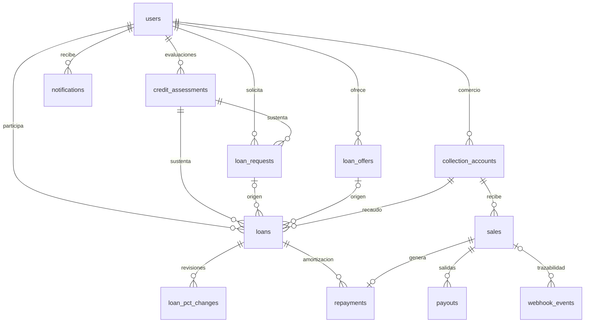

# Modelo de datos de Trust

Python mantiene la contabilidad del negocio en 15 tablas. Go mantiene recursos de pago, autorizaciones y trabajos en una base independiente. Los identificadores remotos conectan ambas representaciones sin llaves foráneas entre bases.

## Convenciones de persistencia

En Trust los IDs son UUID, las fechas usan `timestamptz` y se devuelven en UTC, los montos usan `bigint` y los snapshots usan `jsonb`. Los estados se guardan como texto con restricciones `CHECK` cuando corresponde. Los importes de entrada están limitados al rango de `bigint` con signo, hasta `2^63 - 1`.

Go representa montos del protocolo con enteros en texto de precisión arbitraria. Esa capacidad no amplía el rango que admite la contabilidad Python. Las conversiones deben conservar `asset_code` y `asset_scale`; no se deben sumar importes de assets distintos.

Fuentes: [db.py](../../backend/app/core/db.py), [money.py](../../backend/app/core/money.py), [amount.go](../../open-payments/internal/domain/amount.go).

## Tablas de negocio

| Tabla | Contenido y relaciones relevantes |
| --- | --- |
| `users` | Identidad, rol, hash de contraseña, negocio, wallet propia y rango del prestamista; correo único |
| `collection_accounts` | Comercio, ID remoto Go, wallet, QR, asset, estado y libro de entradas/salidas |
| `credit_assessments` | Comercio, versión de política, score, grado, elegibilidad, cupo, features y razones; snapshot histórico |
| `loan_requests` | Comercio, rango, porcentaje, estado y evaluación usada para solicitar |
| `loan_offers` | Prestamista, rango, porcentaje, cargo, plazo y estado |
| `loans` | Partes, origen, solicitud/oferta opcionales, evaluación, cuenta, wallets y términos congelados, estados y acumulados |
| `loan_pct_changes` | Crédito, periodo revisado, objetivo, abonos, porcentaje anterior/nuevo y motivo |
| `sales` | Comercio, cuenta, referencia Bre-B, ID de evento, monto, fecha de pago, origen `live`/`seed` y estado |
| `repayments` | Un abono por venta: crédito, partes, bruto, parte Trust, neto prestamista y acumulados antes/después |
| `payouts` | Salida de una venta hacia comercio, prestamista o Trust; destino, monto, intento, entrega acumulada y estado remoto |
| `webhook_events` | Evento recibido o reconciliado, payload, resultado, venta asociada y error de conciliación |
| `notifications` | Aviso del usuario, tipo, título, cuerpo, datos y fecha de lectura |
| `waitlist` | Tipo de interesado, nombre, correo único normalizado y ciudad |
| `events` | Auditoría de entidad, operación, actor opcional, datos y fecha |
| `op_cursors` | Cursores persistentes de conciliación del simulador y cierre diario; clave `name` |

Los modelos se registran en [app/models.py](../../backend/app/models.py). `events` está definido en [core/events.py](../../backend/app/core/events.py); las demás tablas se distribuyen en `modules/*/models.py`.

El diagrama muestra relaciones principales, no todas las columnas ni las referencias de actor. `users → loans` representa los roles de comercio, prestamista y creador. Una solicitud/oferta puede aparecer en varios créditos históricos liberados, pero solo en uno que conserve su reserva.

## Invariantes y concurrencia

| Restricción | Implementación |
| --- | --- |
| Una cuenta de recaudo activa por comercio | Índice único parcial sobre `collection_accounts.merchant_id` con `status='active'` |
| Una solicitud abierta por comercio | Índice único parcial con `status='open'` |
| Un crédito no terminal por comercio | Índice parcial para `pending_acceptance`, `pending_disbursement`, `disbursing`, `active` |
| Una reserva vigente por solicitud/oferta | Índices parciales que excluyen créditos `cancelled`, `rejected`, `expired` |
| Un evento recibido por ID | `webhook_events.event_id` único |
| Una venta por referencia de cuenta | Unicidad de `(collection_account_id, bre_b_reference)` y de `puntored_event_id` |
| Un abono por venta | `repayments.sale_id` único |
| Una salida por destinatario lógico de la venta | Unicidad de `(sale_id, leg)` en `payouts` |
| No asignar más que el total del crédito | `allocated_total <= total_repayable` |

La recepción de una venta bloquea primero la cuenta de recaudo y luego el crédito. Los workers respetan el orden cuenta → crédito → payout cuando modifican esas entidades. Las selecciones de trabajo usan `FOR UPDATE` y, donde corresponde, `SKIP LOCKED`. Los índices respaldan las reglas cuando dos peticiones compiten.

Los servicios Python separan las llamadas a Go de las transacciones con bloqueos y después aplican resultados comprobando que el intento siga vigente. Los eventos de auditoría se insertan en la transacción de la mutación. Esto no constituye una transacción distribuida con las wallets: los estados intermedios y la conciliación son parte del modelo.

## Contabilidad y estados de entrega

| Campo | Significado |
| --- | --- |
| `collection_accounts.ledger_in` | Ventas registradas como entradas a esa cuenta |
| `collection_accounts.ledger_out` | Débitos de salidas confirmados por el worker, incluidos envíos parciales reconocidos |
| `loans.allocated_total` | Abono bruto asignado al crédito por las ventas |
| `loans.delivered_total` | Débitos confirmados de las salidas del prestamista y Trust, en el asset del crédito |
| `loans.trust_earned` | Parte de Trust devengada por los repartos |
| `loans.trust_pending` | Parte de Trust acumulada que aún no se convirtió en un payout |
| `payouts.sent_total` | Monto debitado acumulado entre intentos de una misma salida |
| `payouts.current_debit_amount` | Monto a enviar en el intento vigente |
| `payouts.receive_value` y asset receptor | Resultado recibido, que puede estar en otro asset |

`trust_pending=0` no significa que Trust haya cobrado: el dinero puede estar representado por un payout pendiente. Tampoco el libro local es una consulta al saldo bancario actual ni un libro mayor de partida doble.

Las ventas se marcan `processed` o `held`. Una venta válida en una cuenta revocada conserva el registro y sus salidas quedan retenidas. Un evento desconocido o incompatible se conserva como `unmatched`; otros tipos, incluidos reversos, se guardan como `ignored` y no generan una reversión contable automática.

Los payouts admiten `pending`, `processing`, `completed`, `failed_final`, `held` y `skipped`. El saldo remanente de una salida se calcula como `amount - sent_total`. Un fallo remoto con entrega parcial puede originar un nuevo intento solo por ese remanente.

Fuentes: [modelos de ventas](../../backend/app/modules/sales/models.py), [servicio de ventas](../../backend/app/modules/sales/service.py), [worker](../../backend/app/worker.py).

## Persistencia de Go

Las [migraciones SQL](../../open-payments/migrations/) crean las siguientes estructuras de aplicación:

| Grupo | Tablas | Uso |
| --- | --- | --- |
| Recursos e idempotencia | `resources`, `idempotency_records` | Representación pública de cuentas/pagos/transferencias y replay de peticiones |
| Autorización | `grant_sessions`, `resource_sessions`, `grant_attempts` | Grants cifrados, asociaciones e intentos de consentimiento |
| Trabajo durable | `jobs`, `resource_flows` | Cola con leases y estado cifrado de ejecución |
| Pool de recaudo | `pool_wallets`, `collection_wallets` | Descubrimiento y asignación de wallets, incluidas asignaciones históricas |
| Simulación y entrega | `sim_entries`, `webhook_outbox` | Secuencia terminal para conciliación y webhook pendiente de entrega |
| Formularios QR | `qr_forms`, `qr_rate_limits` | Formularios de un uso y límite por IP |

La migración 004 permite conservar asignaciones históricas de una wallet mientras exige una única asignación activa. El almacén registra las migraciones y verifica sus checksums al arrancar.

Los grants, flujos y trabajos sensibles se cifran con AES-256-GCM. La clave deriva por HKDF de la semilla Ed25519 de `OP_PRIVATE_KEY`; el ID del registro se autentica como datos asociados. Cambiar esa clave privada exige migrar el material cifrado con la clave anterior, además de actualizar el registro externo de la wallet.

Fuentes: [persistence/store.go](../../open-payments/internal/persistence/store.go), [workflow/store.go](../../open-payments/internal/workflow/store.go), [vault.go](../../open-payments/internal/workflow/vault.go).

## Idempotencia y recuperación

Go asocia `Idempotency-Key` al método, ruta y hash del cuerpo canónico. Conserva respuestas 2xx y errores definitivos de los tipos admitidos durante 72 horas. La misma clave con otro cuerpo devuelve `409 idempotency_conflict`; una petición en curso devuelve `409 request_in_progress`. El replay incluye `Idempotent-Replayed: true`.

| Operación de Trust | Clave |
| --- | --- |
| Primer recaudo | `merchant:{uuid}:recaudo` |
| Reasignación tras revocación o intento agotado de pool | `merchant:{uuid}:recaudo:{n}` según historial local |
| Salida de reparto | `payout:{uuid}:{attempt}` |
| Desembolso | `loan:{uuid}:disb:{attempt}` |
| Venta simulada | `sim:{uuid}` |

Ante timeout, 5xx o resultado ambiguo de creación, se conserva la clave del intento. Un fallo terminal confirmado puede habilitar el intento siguiente. En Go, antes de crear un outgoing se persiste un checkpoint; si la respuesta se pierde, el servicio busca la operación por metadata `op_operation_id` y `external_ref`. No encontrarla todavía no autoriza duplicar el envío.

La idempotencia HTTP dura 72 horas; una recuperación de incidentes más antiguos necesita revisar también recursos remotos y contabilidad, no limitarse a reenviar la clave. La idempotencia de Go no es un mecanismo genérico aplicado a todos los POST públicos de Trust.

Fuentes: [cliente HTTP](../../backend/app/integrations/op/http.py), [worker Go](../../open-payments/internal/application/worker.go), [conciliación remota](../../open-payments/internal/openpayments/reconcile.go).

## Evolución del esquema

Python ejecuta `create_all` al iniciar: crea tablas faltantes, pero no transforma columnas existentes. No hay un historial de migraciones Python equivalente al de Go. Cada cambio de esquema desplegado necesita un procedimiento de migración explícito y compatible con los datos existentes. Restaurar código anterior no restaura automáticamente un esquema anterior.
